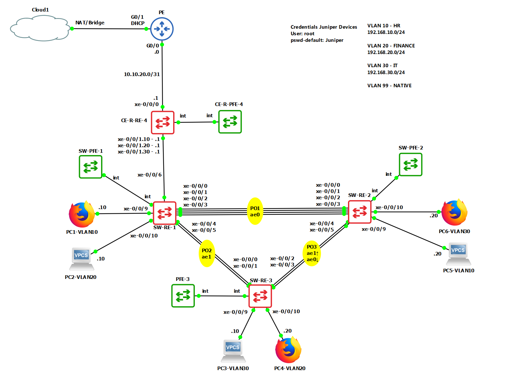

# 06 - Segmented Network | Juniper vQFX + Cisco

**Autor:** Camilo Andrés Gutiérrez Rodríguez 
**Herramienta:** GNS3 | Juniper vQFX · Cisco IOSv  
**Tipo:** Proyecto individual

## Descripción
Diseño y validación de una red segmentada multi-vendor en GNS3 con 
switches Juniper vQFX en capa 2 y 3, y un router Cisco como PE 
para salida a Internet mediante NAT/PAT.

## Tecnologías
Juniper JunOS · VLAN 802.1Q · LACP (LAG) · RSTP · 
Inter-VLAN Routing · Subinterfaces 802.1Q · NAT/PAT · 
Cisco IOS · Multi-vendor

## Arquitectura
- **SW-RE-1:** Root Bridge principal (prioridad 0) · LACP PO1 y PO2
- **SW-RE-2:** Root Bridge secundario (prioridad 4096) · LACP PO1 y PO3
- **SW-RE-3:** LACP PO2 y PO3
- **CE-R-RE-4:** Inter-VLAN Routing vía subinterfaces xe-0/0/1.10/20/30 + ruta estática predeterminada
- **PE Cisco:** NAT/PAT hacia Cloud (NAT/Bridge)

## VLANs
| VLAN | Nombre | Subred |
|------|--------|--------|
| 10 | HR | 192.168.10.0/24 |
| 20 | FINANCE | 192.168.20.0/24 |
| 30 | IT | 192.168.30.0/24 |
| 99 | NATIVE | — |

## Topología

## Resultados Validados
- Operación correcta de grupos LACP (PO1, PO2 y PO3)
- SW-RE-1 elegido como root bridge, SW-RE-2 como secundario, validación de funcionamiento RSTP
- CE-R-RE-4, Comunicación entre las tres VLANs vía Inter-VLAN Routing y configuración de ruta estática predeterminada
- Salida a Internet a través del PE Cisco con NAT/PAT

## Documentación completa
[Ver PDF](docs/Informe_RedJuniper.pdf)

## Configuraciones
[Ver configs](configs/)
